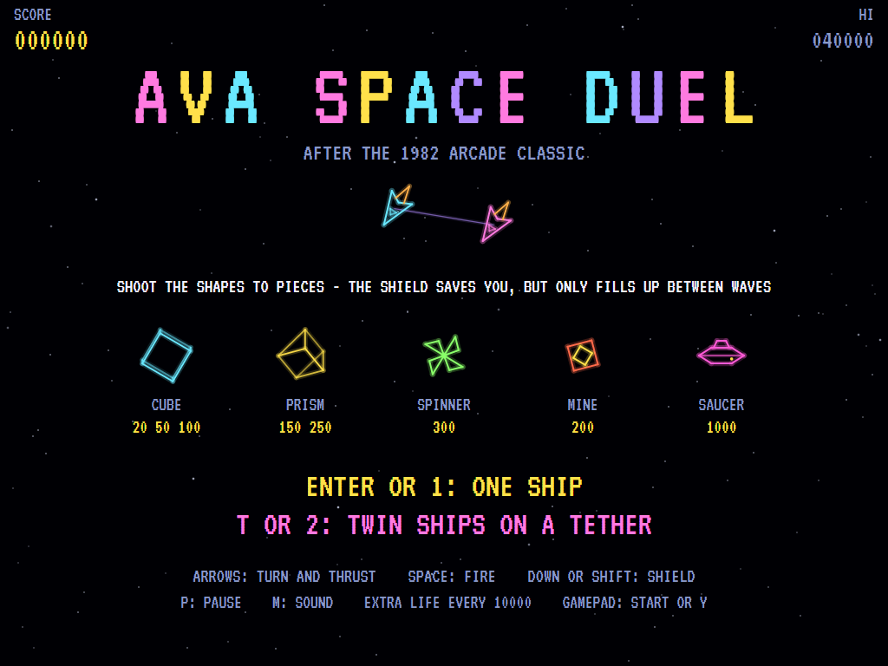
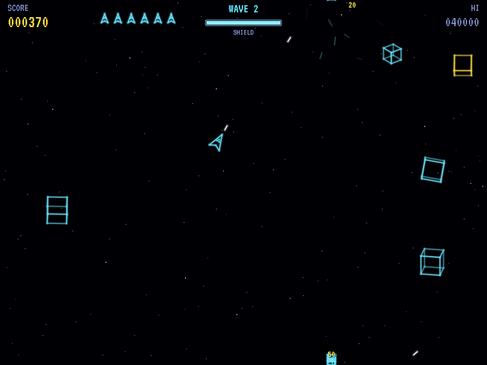
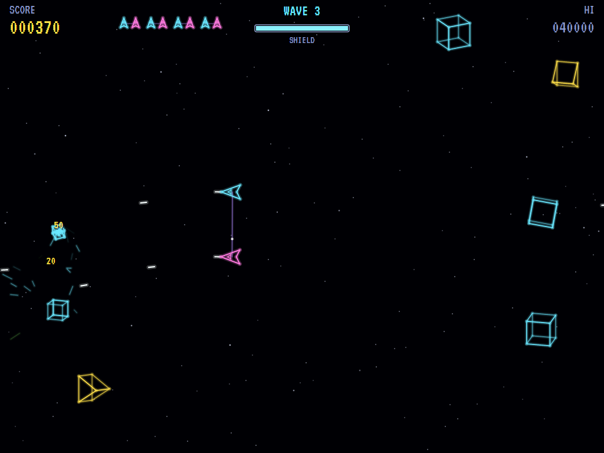
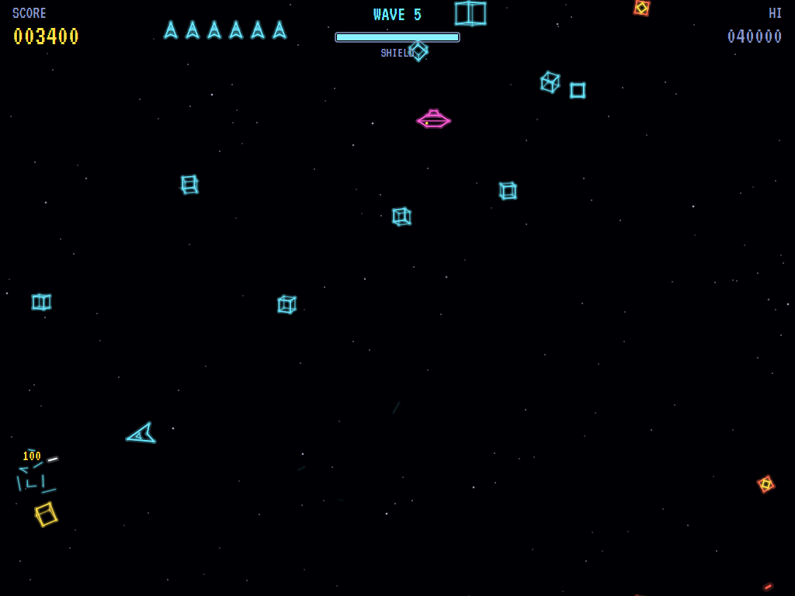
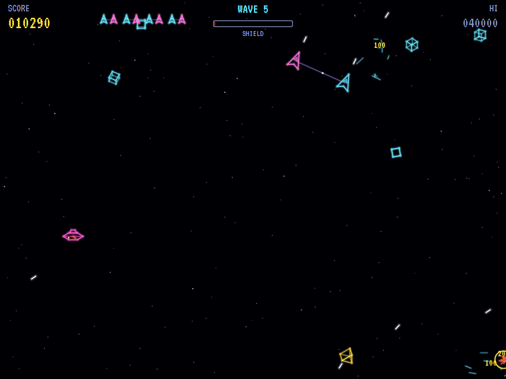
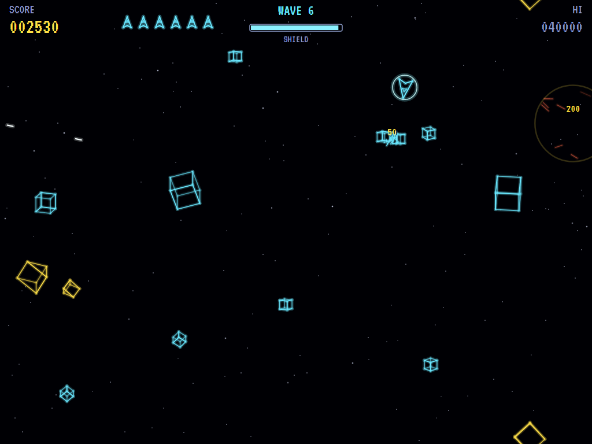
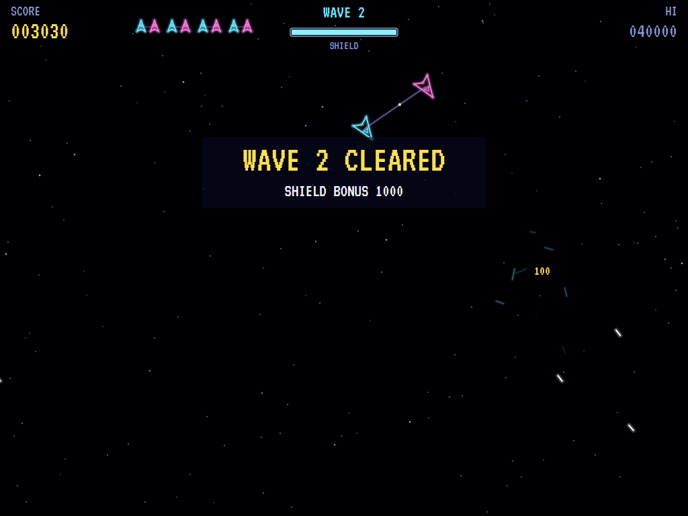
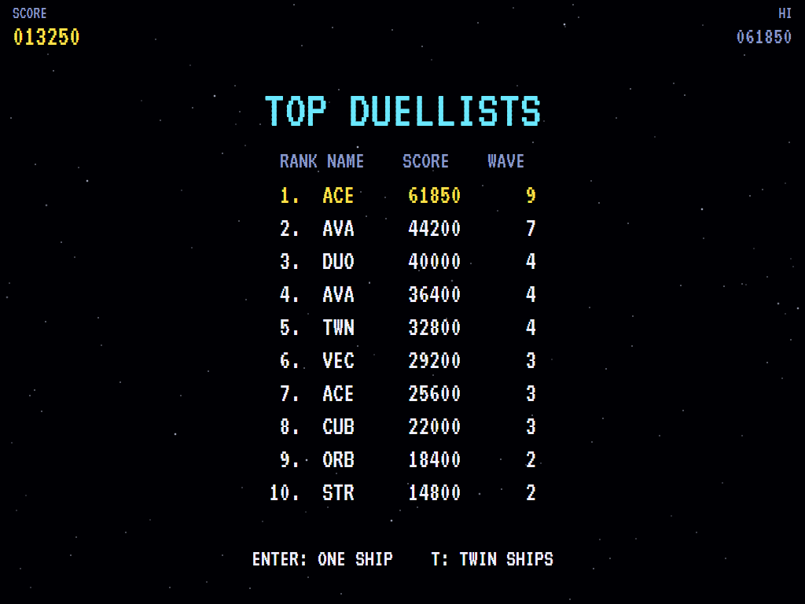

# AVA Space Duel

[](https://github.com/Harlock123/AVASpaceDuel/actions/workflows/build.yml)

A colour vector shooter in the style of Atari's 1982 arcade game **Space Duel**, built with .NET 10 and
Avalonia UI. Fly one ship, or two joined by a tether that swing round as one and fire together, through
waves of glowing wireframe shapes: cubes that break into smaller cubes, prisms that shatter, pinwheels that
follow you, mines that home in, and a saucer that shoots back. Space wraps round at the edges, and a shield
saves you from what you can't shoot in time. It only fills up again between waves, though.

## Features

- **One ship or twins**: choose on the title.
  - **One ship:** turn, thrust and fire, Asteroids-style, drifting with real momentum.
  - **The twins:** two ships at either end of a tether, both facing the same way. Turning swings the pair
    round their middle, thrust drives them along, and both fire at once. Lose one and the other flies on
    alone; lose both and the life is gone, and the next one is a pair again.
- **The shield**: a bubble that bounces shapes away and stops the saucer's shots. It drains while it's up
  (faster for the twins, with two bubbles to keep up) and only fills up again between waves. Whatever's left
  at the end of a wave is worth 10 points a unit.
- **The shapes**, drawn as glowing lines, the cubes and prisms turning in three dimensions:
  - **Cubes** (20) break into two smaller cubes (50), and those into two smaller still (100).
  - **Prisms** (150) shatter once into two shards (250).
  - **Spinners** (300), pinwheels that drift after you.
  - **Mines** (200), from the third wave, come in through the wave and home in faster the longer they're
    out. Shot or run into, a mine goes off and takes whatever's near with it.
- **The saucer** (1000), from the second wave, crosses the screen weaving and shooting at you, closer to
  the mark each wave.
- **Each wave** brings more shapes, more kinds of them and quicker. There's an extra life every 10000.
- **The attract mode** plays itself, taking turns with one ship and the twins: a computer player that leads
  its targets, lines up one twin's guns rather than the empty middle of the tether, and shields when
  something's about to hit.
- **The sounds** are all synthesised: shots, shapes breaking, mines going off, the saucer's warble and the
  title theme.

## Screenshots

| The title | One ship | The twins |
|:---------:|:--------:|:---------:|
|  |  |  |
| The shapes, and the choice. | Cubes and prisms breaking up. | Two ships on a tether, both firing. |

| Mines | The saucer | The shield |
|:-----:|:----------:|:----------:|
|  |  |  |
| Homing in. | Shooting back. | Up just in time. |

| A wave cleared | The high scores | |
|:--------------:|:---------------:|:-:|
|  |  | |
| The bonus for the shield left. | The top duellists. | |

The screenshots are made by the tests, which play the game in a real (headless) window; see
[Tests](#tests).

## Download and run

Ready-to-run builds for Windows, macOS and Linux, on both Intel/AMD and ARM, are on the
[Releases page](https://github.com/Harlock123/AVASpaceDuel/releases/tag/latest). **Latest build** is
rebuilt on every push to `main`. Each download is one self-contained executable: no .NET install is
needed.

| Platform | Archive |
|---|---|
| Windows | `AVASpaceDuel-win-x64.zip`, `AVASpaceDuel-win-x86.zip`, `AVASpaceDuel-win-arm64.zip` |
| macOS | `AVASpaceDuel-osx-arm64.tar.gz` (Apple silicon), `AVASpaceDuel-osx-x64.tar.gz` (Intel) |
| Linux | `AVASpaceDuel-linux-x64.tar.gz`, `AVASpaceDuel-linux-arm64.tar.gz`, `AVASpaceDuel-linux-arm.tar.gz` |

```bash
tar -xzf AVASpaceDuel-linux-x64.tar.gz     # or linux-arm64, linux-arm, osx-arm64, osx-x64
./AVASpaceDuel
```

On Windows, unzip and run `AVASpaceDuel.exe`. On macOS, if Gatekeeper refuses to open it, run
`xattr -d com.apple.quarantine AVASpaceDuel` once. Run with `--no-audio` for silence.

**Sound** comes through OpenAL Soft, built in for every platform. In a virtual machine the game
detects it and uses a larger audio buffer, so the sound doesn't break up.

**Gamepads** use SDL2, which is bundled for Windows, macOS and Intel/AMD Linux. ARM Linux builds need it
installed; without it the keyboard still works:

```bash
sudo apt install libsdl2-dev            # Debian / Ubuntu / Raspberry Pi OS
sudo pacman -S --needed sdl2-compat     # Arch / Omarchy
```

## Controls

| Input | Action |
|-------|--------|
| **Enter** | Start |
| **Arrow keys** / **W A S D** | Walk (diagonals too) |
| **Space** / **Z** / **X** / **Ctrl** | Shoot an arrow, the way you last walked (in a room) |
| **P** / **Esc** | Pause (Esc again to quit) |
| **M** | Mute |
| **Ctrl+S** / **Cmd+S** | Save a screenshot to the Pictures folder |

**Gamepad**: left stick or D-pad to walk, **A**, **B**, **X** or the right trigger to shoot, **Start** to
start and pause, **Back** (while paused) to quit.

**Entering initials**: type letters, or dial with **Up**/**Down** and accept with **Space**; **Left** /
**Backspace** go back; **Enter** finishes.

## Controls

| Action | Keyboard | Gamepad |
|---|---|---|
| Start with one ship | Enter or 1 | Start |
| Start with the twins | T or 2 | Y |
| Turn | Left / Right (or A / D) | Left stick / D-pad |
| Thrust | Up (or W) | Up, B or left trigger |
| Fire | Space, Z or Ctrl | A or right trigger |
| Shield | Down, S, Shift or X | Down or X |
| Pause | P or Esc | Start |
| Sound on/off | M | |
| Screenshot | Ctrl+S (to your Pictures folder) | |

On the high-score table, type your initials, or use up/down and Space, then Enter.

## Tests

```bash
dotnet test AVASpaceDuel.slnx
```

The engine has no UI and runs in fixed 60 Hz steps, so it plays the same at any frame rate, and a seed
always plays the same game. The tests check:

- **The craft:**
  - space wrapping round
  - turning, thrust, drag and a top speed
  - shots from the nose, so many at once
  - the twins swinging round their middle and both firing
- **The shapes:**
  - cubes breaking twice, prisms once
  - spinners and mines just going, and a mine taking its neighbours with it
  - spinners and mines following
- **Hit:**
  - a shape on the ship
  - safety after coming back, and the shield bouncing shapes away
  - the shield running out and filling up only between waves
  - one twin lost and the other flying on
  - the last life
- **The saucer:** coming across shooting, shot down for 1000, and its shots stopped by the shield
- **Waves:** more and more kinds of shape, coming in away from the craft; the shield bonus; extra lives
- **The machine:** one ship or the twins from the title, the demonstrations taking turns, the computer player clearing the first wave both ways, the same game from the same seed, and pausing

The screenshot tests draw the real screen in a headless window. To refresh the README's pictures:

```bash
SPACEDUEL_SHOTS=$PWD/Images dotnet test tests/AVASpaceDuel.Tests --filter ScreenshotTests
```

To see how the computer player gets on, wave by wave (for tuning; `1` for one ship, `twin` for the twins):

```bash
SPACEDUEL_PROBE=twin dotnet test tests/AVASpaceDuel.Tests --filter PilotProbe --logger "console;verbosity=detailed"
```

## Building

```bash
dotnet build AVASpaceDuel.slnx
dotnet run --project src/AVASpaceDuel
```

Needs the .NET 10 SDK. The sounds are made by `tools/make_sounds.py` (standard-library Python):
`python3 tools/make_sounds.py` rewrites `src/AVASpaceDuel/Sounds`.

## Project structure

```
AVASpaceDuel/
├── AVASpaceDuel.slnx
├── src/AVASpaceDuel/
│   ├── Engine/
│   │   ├── GameEngine.cs        # States, the title and demo cycle (one ship or the twins), the saucer's warble
│   │   ├── GameEngine.Play.cs   # The craft and the tether, shots and the shield; the shapes, mines and
│   │   │                        # saucer; waves and scoring
│   │   ├── ShipPilot.cs         # The computer player, for the demonstration (and the tests)
│   │   ├── Entities.cs          # Wrapping space, the craft, the shapes and the saucer
│   │   ├── HighScoreTable.cs, InitialsEntry.cs
│   │   ├── InputHandler.cs, ControllerManager.cs  # Keys and an SDL2 gamepad
│   │   └── SoundManager.cs      # Effects and the tunes through OpenAL
│   ├── Audio/                   # The OpenAL engine (from the author's AVABand)
│   ├── Views/                   # The vector drawing: wireframes, ships, the tether and the screens
│   └── Sounds/                  # The synthesised effects and tunes
├── tests/AVASpaceDuel.Tests/    # Gameplay, screenshot and probe tests
├── tools/make_sounds.py
└── Images/                      # Screenshots
```

## About and licence

AVA Space Duel © 2026 Lonnie Watson, under the [MIT License](LICENSE).

*Space Duel* © 1982 Atari; the name belongs to its current owner. AVA Space Duel is an independent,
unofficial game in its style. Its ships and tether, its shapes, mines and saucer, its graphics, sounds,
tunes and code are its own; nothing is taken from the arcade machine's program, graphics, sound or music.
It is not affiliated with or endorsed by any rights holder.
